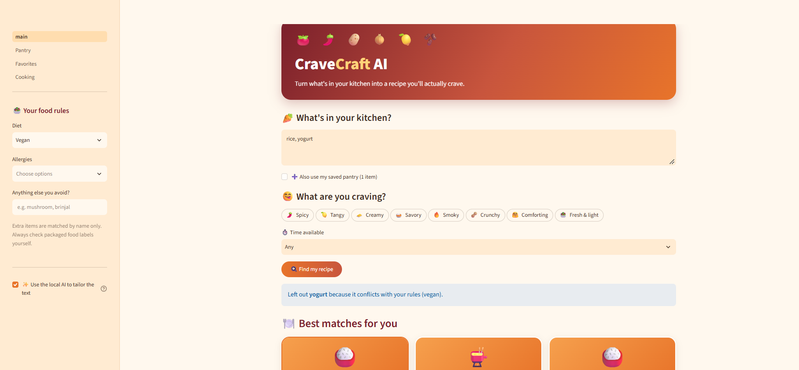
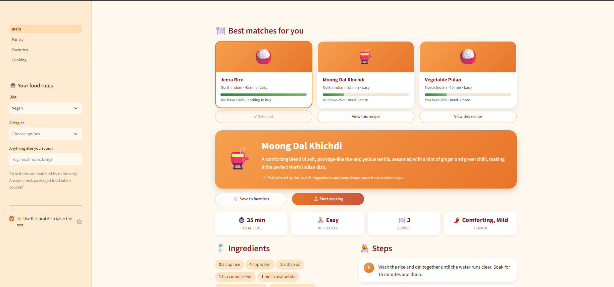
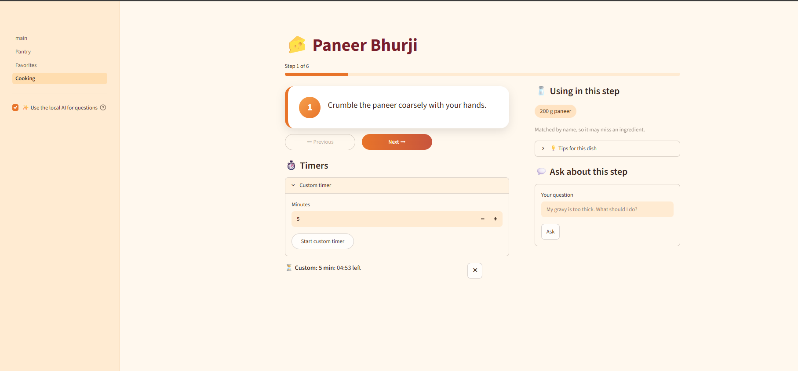

# 🍛 CraveCraft AI

A free, offline, AI-assisted Indian cooking companion. Tell it what is in your kitchen and what you are craving, and it finds a tested recipe, adapts the text to you with a **local** language model, and guides you step by step while you cook.

No paid APIs, no cloud, no GPU. It runs on a laptop with 8 GB of RAM.



## Features

- **Ingredient-based search**: type what you have, including Hindi names (tamatar, aloo, palak).
- **Safety-first filtering**: diets (vegetarian, eggetarian, vegan, Jain), common allergens and a free-text "avoid" list are applied before and after any AI text is generated.
- **Real recipes, AI-tailored text**: the 1.5B model never writes ingredients or steps. It only writes the description, tips and substitutions.
- **Smart pantry**: saved ingredients with expiry dates; items expiring soon boost matching recipes.
- **Favorites, ratings and history** stored locally in SQLite.
- **Cooking mode**: step navigation, progress bar, timers detected from the recipe text, and a Q&A box for kitchen problems.
- **Works without AI**: if Ollama is off or fails, the app shows the tested recipe as written.

| Recipe page | Cooking mode |
|---|---|
|  |  |

## How it works

```
Pantry text -> safety filter on ingredients -> safe recipes (32)
            -> ranker (coverage, craving, time, use-first, recent)
            -> LLM adapter (description, tips, substitutions only)
            -> safety re-check of every AI sentence -> recipe card
```

| Layer | What it does |
|---|---|
| `core/safety` | Deterministic keyword matching on whole words, safe phrases (coconut milk is not dairy), diet rules |
| `core/recommender` | Ingredient normalization (plurals, Hindi aliases), staples, scoring |
| `core/ai` | Ollama client, schema-constrained JSON, retry and fallback |
| `core/services` | Cooking-mode logic: timers, step ingredients, quick answers |
| `db` | SQLAlchemy models and repository for pantry, favorites, history |
| `app` | Streamlit UI |

### Why the model does not write the recipe

I benchmarked `qwen2.5:1.5b` on an i3 laptop with 8 GB RAM (about 17 tokens/s, 1.2 GB RAM). It produced valid JSON every time, but the recipes were weak: no spices, a step telling the cook to preheat an oven for a pot curry, and in one vegan and peanut-allergy run it copied the entire forbidden list into the shopping list. So the design changed: retrieve a real recipe, let code handle ingredients, quantities and safety, and use the model only for short tailored text, with every sentence checked.

## Run it locally

Requires Python 3.13, [Ollama](https://ollama.com) (optional, for AI text), and about 2 GB of free disk space.

```powershell
git clone https://github.com/<your-github-username>/cravecraft-ai.git
cd cravecraft-ai
python -m venv .venv
.\.venv\Scripts\Activate.ps1
pip install -r requirements.txt
Copy-Item .env.example .env

ollama pull qwen2.5:1.5b       # optional: enables AI-tailored text
streamlit run app/main.py
```

Run the tests:

```powershell
python -m pytest -q
```

## Limitations

- **Not a replacement for allergy care.** Safety checks are keyword matching on ingredient names and cannot see hidden ingredients in packaged food. Always read labels.
- **32 recipes** written from general knowledge, not professionally tested.
- Timers run only while the page is open and have no sound.
- The small local model can be wrong; its answers are labelled in the UI.
- Nutrition values, photo ingredient detection and recipe images are not built yet.

## Roadmap

Nutrition estimates from USDA data, recipe remix, photo ingredient detection, more recipes, Hindi UI.

## License

MIT, see [LICENSE](LICENSE).